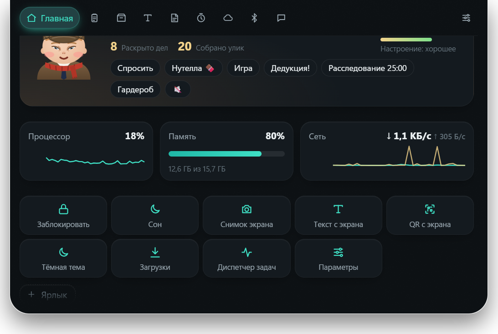
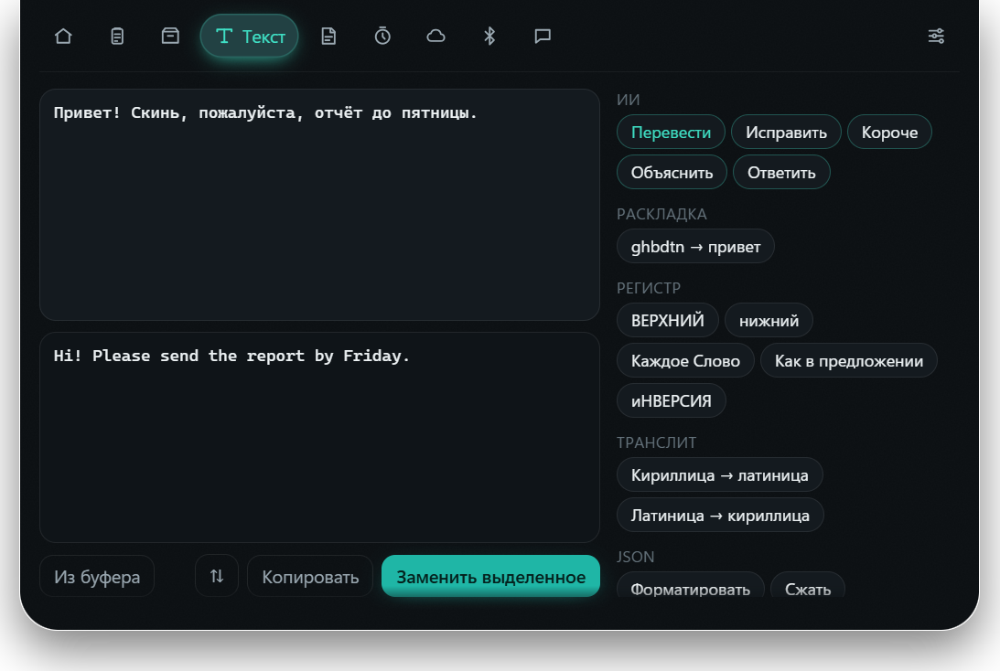
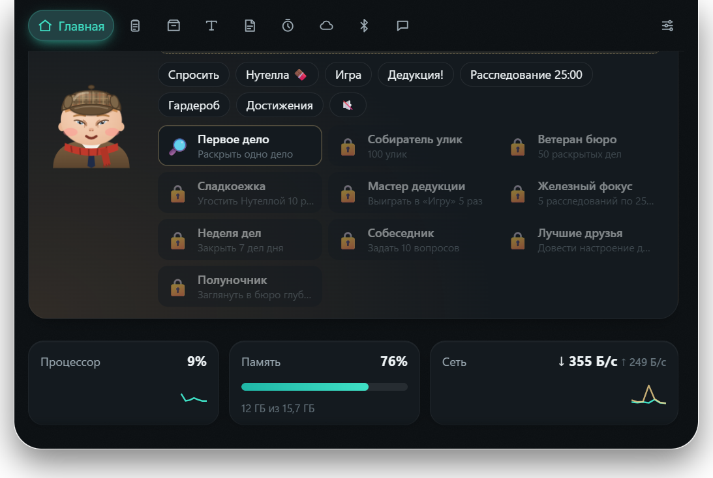
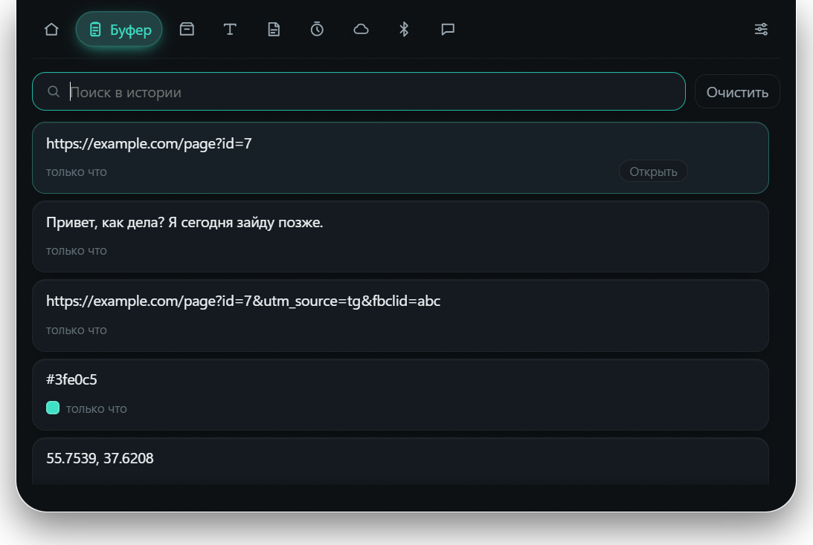
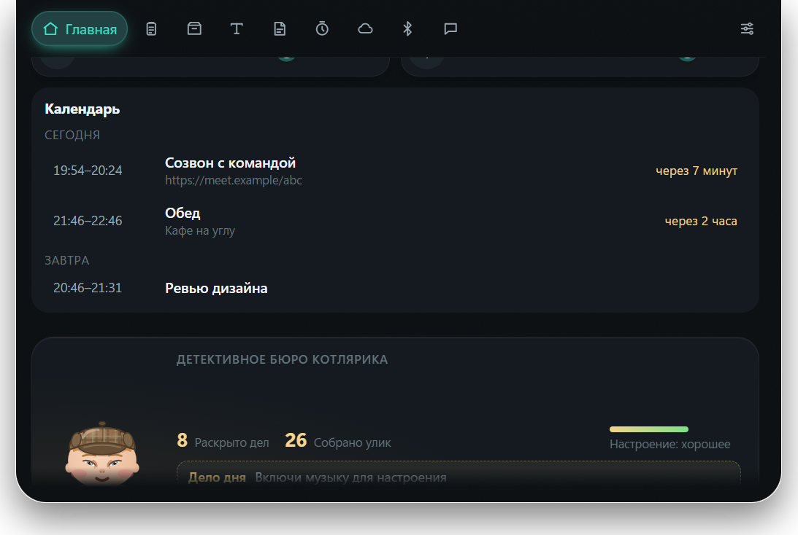
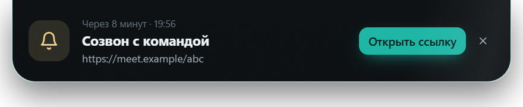
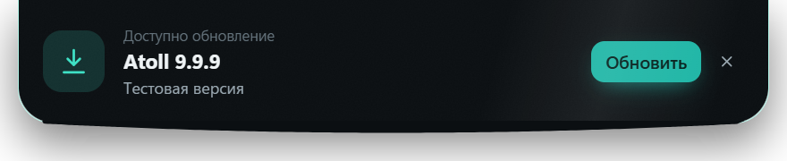

# 🏝️ Dinisland

**Динамический остров для Windows 10 и 11**

Музыка, буфер обмена, заметки, таймеры, календарь, ИИ и питомец‑детектив — 
в аккуратной пилюле у верхнего края экрана.

[**⬇️ Скачать последнюю версию**](https://github.com/Sneggg349/dinisland-releases/releases/latest)

Бесплатно · все функции включены · обновляется сам

 

---

## Что умеет

| | |
|---|---|
| 🎵 **Музыка** | Обложка, управление любым плеером (Spotify, Яндекс Музыка, браузер), синхронный текст песни. Цвет обложки окрашивает остров. |
| 📋 **Буфер обмена** | История с поиском и закреплением, вставка в один клик. Умные кнопки: открыть ссылку и убрать из неё метки отслеживания, показать цвет, перевести или исправить текст. |
| ✨ **ИИ над выделенным** | Выделите текст в любой программе, нажмите <kbd>Ctrl</kbd>+<kbd>Alt</kbd>+<kbd>X</kbd> — перевести, исправить, сократить, объяснить, ответить. Результат встаёт на место выделенного. |
| 🎙️ **Голосовые заметки** | <kbd>Ctrl</kbd>+<kbd>Alt</kbd>+<kbd>N</kbd> — говорите, текст сохранится заметкой. Диктовка работает и в чате. |
| 📝 **Заметки** | С форматированием, цветными пометками, списками и папками. |
| ⏱️ **Таймеры и напоминания** | Обычной фразой: «таймер 10 мин», «напомни позвонить маме завтра в 9», «таблетки каждый день в 23:00». |
| 📅 **Календарь** | Ближайшие встречи из Google, Outlook или Яндекса и напоминание за несколько минут до начала. |
| 🌙 **Не беспокоить** | Уведомления копятся и не мешают, после — короткая сводка пропущенного. |
| 💬 **Чат с ИИ** | Groq, Gemini, OpenRouter, DeepSeek или любой OpenAI‑совместимый сервис. Можно прикреплять картинки и файлы. |
| 🔎 **Котлярик** | Питомец‑сыщик: следит за курсором, радуется событиям, ест Нутеллу, играет, выдаёт «дело дня» и собирает достижения. |
| 🧰 **И ещё** | Полка для файлов, командная строка с калькулятором и конвертером, текст и QR с экрана, погода, Bluetooth‑устройства, монитор системы, уведомления других программ. |

 Выделили текст, нажали Ctrl+Alt+X — и перевод готов
  

 Котлярик, его дела и достижения
  

 Буфер обмена: у ссылки — «Открыть» и «Без меток», у цвета — образец
  

 Ближайшие встречи на «Главной»
  

---

## Установка

1. Откройте [последний релиз](https://github.com/Sneggg349/dinisland-releases/releases/latest) и скачайте файл **`Dinisland_…_x64-setup.exe`**.
2. Запустите его. Если появится синее окно **«Система Windows защитила ваш компьютер»** — нажмите **«Подробнее»**, затем **«Выполнить в любом случае»** (почему так — в [вопросах ниже](#почему-windows-предупреждает-при-установке)).
3. Остров появится у верхнего края экрана. Наведите на него курсор — он раскроется.

Dinisland сам добавится в автозагрузку и будет запускаться вместе с Windows. Найти его можно в меню «Пуск».

### Подключите ИИ (по желанию, бесплатно)

Перевод, исправление текста, голосовые заметки, чат и вопросы питомцу работают через ИИ. Нужен ключ — его выдают бесплатно:

1. Откройте настройки (значок ⚙ на острове) → **«ИИ»**.
2. Выберите сервис — проще всего **Gemini** — и нажмите **«Получить ключ»**.
3. Вставьте ключ, нажмите **«Сохранить»**, затем **«Проверить»**.

Ключ хранится только на вашем компьютере в зашифрованном виде.

---

## Горячие клавиши

| Сочетание | Действие |
|---|---|
| <kbd>Ctrl</kbd>+<kbd>Alt</kbd>+<kbd>I</kbd> | Открыть или закрыть остров |
| <kbd>Alt</kbd>+<kbd>Space</kbd> | Командная строка: программы, файлы, калькулятор, курсы валют |
| <kbd>Ctrl</kbd>+<kbd>Alt</kbd>+<kbd>X</kbd> | ИИ над выделенным текстом |
| <kbd>Ctrl</kbd>+<kbd>Alt</kbd>+<kbd>N</kbd> | Голосовая заметка (начать / закончить) |
| <kbd>Ctrl</kbd>+<kbd>Alt</kbd>+<kbd>V</kbd> | История буфера обмена |
| <kbd>Ctrl</kbd>+<kbd>Alt</kbd>+<kbd>Shift</kbd>+<kbd>V</kbd> | Вставить без форматирования |
| <kbd>Ctrl</kbd>+<kbd>Alt</kbd>+<kbd>A</kbd> | Чат с ИИ |
| <kbd>Ctrl</kbd>+<kbd>Alt</kbd>+<kbd>M</kbd> | Выключить или включить микрофон |
| <kbd>Ctrl</kbd>+<kbd>Alt</kbd>+<kbd>O</kbd> | Распознать текст с экрана |
| <kbd>Ctrl</kbd>+<kbd>Alt</kbd>+<kbd>Q</kbd> | Прочитать QR‑код с экрана |

Любое сочетание можно поменять в настройках → **«Горячие клавиши»**.

---

## Частые вопросы

### Почему Windows предупреждает при установке?
У Dinisland нет платного сертификата подписи кода (он стоит сотни долларов в год), поэтому фильтр SmartScreen не знает программу и показывает предупреждение. Это нормально для небольших бесплатных программ. Обновления при этом подписаны отдельным ключом — подменить их нельзя.

### Как обновлять?
Никак — Dinisland проверяет новые версии сам: через минуту после запуска и затем раз в сутки. Когда выходит новая, на острове появляется карточка «Доступно обновление» — нажмите **«Обновить»**. Проверить вручную: настройки → **«О программе»** → **«Проверить обновления»**.

### Это бесплатно? Есть платные функции?
Бесплатно, все функции включены, без пробных периодов и рекламы. Платить может понадобиться только сервису ИИ, если вы выберете платный, — но у Gemini и Groq есть бесплатные ключи.

### Что с моими данными?
Всё хранится только на вашем компьютере: заметки, история буфера, чаты, настройки. Dinisland ничего не отправляет разработчику. В интернет он обращается только за тем, что вы включили: ИИ‑сервис по вашему ключу, погода (Open‑Meteo), тексты песен (LRCLIB), курсы валют, ваш календарь по ссылке и проверка обновлений на GitHub.

### Остров попадёт на скриншоты и запись экрана?
По умолчанию нет — он скрыт от снимков, записи и трансляций экрана. Это можно выключить в настройках → **«Внешний вид»**.

### Остров мешает в играх и полноэкранных видео.
В полноэкранных приложениях он прячется сам. Ещё есть **автоскрытие** (остров уходит за край, пока курсор не упрётся в верх экрана, — «Общие») и **сквозной режим** (пилюля пропускает клики, — «Внешний вид»).

### Работает без ИИ?
Да. Без ключа не будут работать только перевод и правка текста, голосовые заметки, чат и вопросы питомцу. Всё остальное работает и так.

### Голосовые заметки не распознают речь.
Распознаёт речь сервис ИИ из настроек. Подходят Gemini (принимает аудио), Groq и OpenAI (Whisper). Проверьте, что ключ сохранён и Windows разрешает приложениям доступ к микрофону (Параметры → Конфиденциальность → Микрофон).

### Как подключить календарь?
Настройки → **«Календарь»**, вставьте ссылку в формате iCal:
- **Google** — настройки календаря → «Интеграция календаря» → «Секретный адрес в формате iCal»;
- **Outlook** — Параметры → Календарь → «Общие календари» → «Опубликовать календарь» → ссылка ICS;
- **Яндекс** — настройки календаря → «Экспорт» → ссылка для iCal.

### Как перенести всё на другой компьютер?
Настройки → **«Копия и перенос»** → «Сохранить копию». На новом компьютере — «Восстановить из файла». Ключ ИИ в копию не попадает, его нужно ввести заново.

### Как убрать из автозагрузки или удалить?
Автозагрузка — настройки → **«Общие»** → «Запускать вместе с Windows». Удалить — Параметры Windows → «Приложения» → «Установленные приложения» → Dinisland → «Удалить».

### Нашёл ошибку или есть идея.
Создайте [issue](https://github.com/Sneggg349/dinisland-releases/issues) — с описанием, что делали и что ожидали увидеть. Скриншот очень поможет.

---

Windows 10 и 11 · x64

